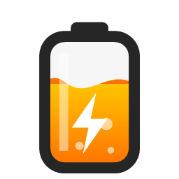
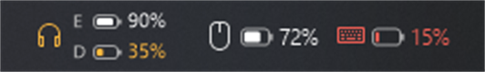

# Juicebar

A bateria dos seus aparelhos sem fio direto na barra de tarefas do Windows: fone, mouse, teclado, controle.

Fones com Fast Pair do Google (por exemplo, vários modelos da JBL) aparecem com cada lado separado, E (esquerdo) e D (direito). O Windows e a maioria dos programas só mostram um número para o fone inteiro.

## Instalar

1. Baixe o `juicebar.exe` da [última versão](https://github.com/caiquebmaso/juicebar/releases/latest).
2. Coloque num lugar fixo, por exemplo `%LOCALAPPDATA%\Juicebar`, e abra com dois cliques.
3. Para abrir sozinho com o Windows: clique direito no Juicebar na barra e marque **Iniciar com o Windows**.

O `.exe` não tem assinatura digital. Na primeira vez o Windows mostra a tela "O Windows protegeu o computador" (SmartScreen): clique em **Mais informações** e depois em **Executar assim mesmo**. Se preferir, compile você mesmo a partir do código (abaixo).

Não precisa instalar nada além disso: o programa usa o .NET Framework 4, que já vem no Windows.

### Compilar a partir do código

1. Baixe ou clone o repositório.
2. Clique duas vezes em `juicebar.bat`. Na primeira vez ele compila o programa em `%LOCALAPPDATA%\Juicebar` com o compilador de C# que já vem no Windows e depois abre. Se o `.cs` mudar, ele compila de novo.

## Como usar

Na barra, à esquerda do clima e da área de notificação:

- cada aparelho conectado tem o seu ícone (fone, mouse, teclado, controle) e uma pilha com a porcentagem, um ao lado do outro;
- cores: branco acima de 40%, laranja até 40%, vermelho até 20%, verde carregando; o ícone pega a cor do nível mais baixo do aparelho;
- passar o mouse mostra todos os aparelhos, cada lado do fone, o estojo e a hora da leitura;
- clique esquerdo abre a janela de detalhes; clique direito tem Detalhes, Iniciar com o Windows e Sair;
- sem nenhum aparelho com bateria conectado, fica só um ícone de Bluetooth apagado.

Para ver o visual sem aparelho nenhum: `juicebar.bat --demo` (fone, mouse e teclado de exemplo, como na imagem acima).

### Abrir com o Windows

Clique direito no Juicebar na barra e marque **Iniciar com o Windows**. Desmarque para tirar.

### Ícone

O `juicebar.ico` é gerado pelo `tools\gerar-icone.ps1` (cada tamanho desenhado do zero).

## De onde vem a bateria

1. **Windows:** a bateria que o Windows já recebe de qualquer aparelho Bluetooth conectado (a mesma de Configurações > Bluetooth). Lida a cada 20 s.
2. **Bluetooth LE:** aparelho LE conectado sem bateria no Windows. O programa lê o serviço padrão de bateria (0x180F / 0x2A19) a cada 2 min.
3. **Fast Pair:** fones que anunciam a bateria de cada lado e do estojo (serviço 0xFE2C). Só vale para fone conectado a este PC, casado pelo nome, para que o fone de outra pessoa por perto não apareça.

Tudo é só leitura: o programa não conecta, não pareia e não grava nada no aparelho.

## O que não entra

- Aparelhos com receptor USB próprio (Logitech Lightspeed/Unifying/Bolt, Razer, Corsair, SteelSeries): cada marca passa a bateria pelo receptor do seu jeito.
- Aparelhos com fio.

## Como ele fica na barra

O programa cria uma janela filha da barra de tarefas (`Shell_TrayWnd`), desenhada com transparência (`UpdateLayeredWindow`), e encolhe a área dos botões (`ReBarWindow32`) para abrir espaço. Se o Explorer reiniciar, ele se encaixa de novo sozinho.

## Requisitos

Windows 10 ou 11, com Bluetooth e .NET Framework 4.x (já vem no Windows).

## Licença

[MIT](LICENSE)
